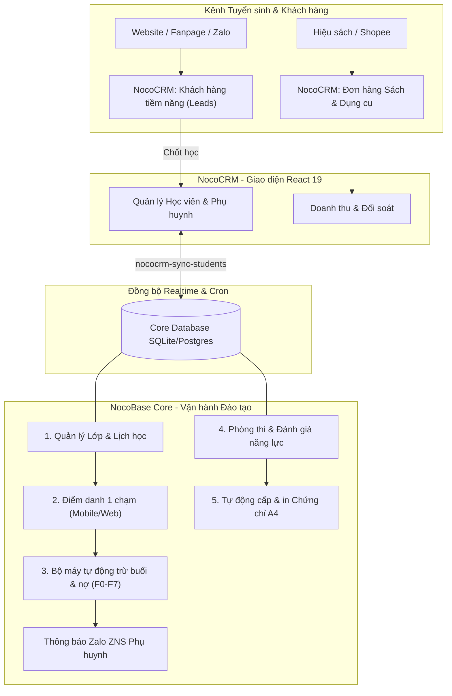

# Kế hoạch tổng thể triển khai NocoBase 3 & NocoCRM (Cờ vua Dương Sinh)

> **Tài liệu chiến lược & lộ trình kỹ thuật dài hạn**
> **Lưu trữ tại repository:** `docs/plans/2026-11-04-ke-hoach-tong-the-nocobase3-nococrm-duong-sinh.md`
> **Áp dụng cho:** Hệ sinh thái quản lý đào tạo cờ vua, thi đấu và hiệu sách của Công ty CP Cờ vua Dương Sinh
> **Nền tảng công nghệ:** NocoBase 3 (Hono + Knex + SQLite/Postgres) + NocoCRM (React 19 + Tailwind CSS + shadcn/ui)

---

## 1. Bối cảnh & Mục tiêu dài hạn

Công ty CP Cờ vua Dương Sinh chốt định hướng chiến lược **đầu tư lâu dài vào nền tảng NocoBase 3 và NocoCRM**:

- **Bỏ lại hạn chế của v2:** Loại bỏ kiến trúc kéo thả Formily nặng nề, khó responsive, render chậm và dễ xung đột khi nâng cấp.
- **Tận dụng sức mạnh v3:** Chuyển sang kiến trúc component React 19 hiện đại, API Hono siêu nhẹ, type-safe, tích hợp sẵn AI Agent, đồng bộ real-time và giao diện mượt mà trên cả desktop lẫn điện thoại.
- **Hợp nhất 2 trụ cột:**
  1. **NocoCRM (`https://nococrm.dsc.edu.vn`):** Mặt tiền quản trị tuyển sinh B2C (học viên cá nhân, phụ huynh), quan hệ đối tác B2B (trường học liên kết, đối tác ký gửi), bán lẻ sách cờ vua và chăm sóc khách hàng.
  2. **NocoBase Core (`https://nocobase.dsc.edu.vn`):** Trung tâm dữ liệu đào tạo chuyên sâu: quản lý lớp học, điểm danh, lịch dạy giáo viên, trừ buổi học tự động, tổ chức kỳ thi, tính toán Elo và xuất chứng chỉ A4 tự động.

---

## 2. Kiến trúc giải pháp tổng thể

---

## 3. Lộ trình triển khai chi tiết (5 Giai đoạn)

### Giai đoạn 1: Hoàn thiện Quản lý Học viên & Phụ huynh trên NocoCRM (Ngay lập tức)

- **Mục tiêu:** Cung cấp ngay giao diện bảng dữ liệu trực quan cho học viên và phụ huynh để đối chiếu và sử dụng hàng ngày.
- **Công việc cụ thể:**
  1. Thêm route và menu **"Students" (Học viên)** trực tiếp trên thanh điều hướng NocoCRM (`client/routes.ts`).
  2. Hiển thị bảng dữ liệu với đầy đủ trường: Mã học viên (`HVxxxxx`), Họ tên, Giới tính, Ngày sinh, Trường học, Lớp, Elo, Cấp độ cờ, Tên phụ huynh, Số điện thoại.
  3. Form chi tiết (Drawer): Cho phép xem và chỉnh sửa thông tin học viên, xem phụ huynh bảo trợ và lịch sử học tập.
  4. Đóng gói và triển khai 1-click lên VPS bằng `deploy-vps.ps1`.

---

### Giai đoạn 2: Quản lý Lớp học & Buổi học (Classroom & Schedule Management)

- **Mục tiêu:** Quản lý cơ sở đào tạo, lớp học, lịch học định kỳ và danh sách học viên trong từng lớp.
- **Cấu trúc dữ liệu:**
  - `dsc_co_so`: Cơ sở đào tạo (Trung Kính, Kim Liên, Online...).
  - `dsc_lop_hoc`: Lớp học (Tên lớp, Cấp độ, Giáo viên phụ trách, Phòng học, Ca học, Thứ trong tuần, Sĩ số tối đa).
  - `dsc_lop_hoc_hoc_vien`: Danh sách học viên ghi danh vào từng lớp.
  - `dsc_buoi_hoc`: Lịch từng buổi học cụ thể (Ngày học, Giờ học, Trạng thái: Chưa diễn ra / Đã học / Nghỉ lễ).
- **Giao diện v3:**
  - Bảng danh sách Lớp học có filter theo Cơ sở, Cấp độ, Giáo viên.
  - Xem chi tiết lớp: Danh sách học viên đang theo học, lịch sử các buổi học.

---

### Giai đoạn 3: Điểm danh 1 chạm & Bộ máy tự tính số buổi học (Attendance & Formulas F0–F7)

- **Mục tiêu:** Giáo viên điểm danh cực nhanh trên điện thoại hoặc máy tính, hệ thống tự động trừ buổi học và cảnh báo phụ huynh.
- **Quy trình vận hành:**
  1. **Giao diện Điểm danh:**
     - Giáo viên mở ca học hôm nay ➔ hiển thị danh sách học viên trong lớp.
     - 1 chạm chọn trạng thái: **Có mặt** (mặc định), **Có phép**, **Nghỉ không phép**, **Học bù**.
     - Nhập nhận xét buổi học (hỗ trợ nút _"✨ Soạn nhận xét AI"_).
  2. **Bộ máy tính toán tự động (`formulas.mjs` tích hợp v3):**
     - Khi lưu điểm danh: Hệ thống tự động trừ `so_buoi_con_lai = so_buoi_con_lai - 1` trong gói học tương ứng (`dsc_dang_ky_goi`).
     - Tự động cộng sao tích lũy cho học viên (`tong_sao`).
     - Khi `so_buoi_con_lai <= 2`: Tự động gắn cờ cảnh báo _"Sắp hết gói học"_ để kế toán liên hệ phụ huynh.
  3. **Tự động hóa thông báo Zalo ZNS:**
     - Tự động kích hoạt hàng đợi gửi tin ZNS thông báo kết quả buổi học cho phụ huynh qua số điện thoại đã liên kết.

---

### Giai đoạn 4: Kỳ thi lên cấp & Tự động xuất Chứng chỉ A4 (Exams & Certificates)

- **Mục tiêu:** Tổ chức kỳ thi định kỳ lên cấp độ cờ, giáo viên chấm bài thực hành, quản lý duyệt và xuất chứng chỉ A4 PDF chuyên nghiệp.
- **Cấu trúc module:**
  - `dsc_ky_thi`: Đợt thi lên cấp (Ngày thi, Cấp độ thi, Hội đồng thi).
  - `dsc_de_thi` & `dsc_the_co`: Bộ đề thi gồm các câu trắc nghiệm thế cờ và ván cờ thực hành.
  - `dsc_chung_nhan`: Bảng cấp chứng chỉ (Mã chứng chỉ `CN#####`, Ngày cấp, Cấp độ đạt được).
- **Tính năng tự động hóa:**
  - Quản lý bấm nút **"Duyệt đạt"** ➔ Tự động cập nhật cấp độ mới cho học viên (`capDoId`), ghi lịch sử thăng hạng (`dsc_lich_su_cap`), cộng 10 sao thưởng.
  - **Tự động in Chứng chỉ A4 ngang:** Tích hợp template vector (chuẩn Typography / Typst / HTML Canvas) để xuất file PDF in ấn chuẩn nét cao gồm: Họ tên học viên, Ngày sinh, Cấp độ đạt chuẩn quốc gia/CLB, Chữ ký Chủ tịch CLB và Mã QR xác thực văn bằng.

---

### Giai đoạn 5: Hiệu sách Cờ vua (B2C & B2B) & Thanh toán VietQR SePay

- **Mục tiêu:** Quản trị toàn diện việc bán lẻ sách, bàn cờ, dụng cụ thi đấu cho phụ huynh và đại lý nhà sách.
- **Tính năng:**
  - Danh mục sản phẩm (`dsc_san_pham`), Quản lý kho và tồn kho (`dsc_kho`, `dsc_ton_kho`).
  - Đơn bán hàng tại quầy và đơn online.
  - Tích hợp cổng thanh toán VietQR tự động khớp đơn (qua webhook SePay đã dựng sẵn).
  - Phân hệ đối soát ký gửi sách với nhà sách đối tác và nhập đơn từ sàn TMĐT Shopee.

---

## 4. Kế hoạch xác minh & Tiêu chuẩn nghiệm thu (Acceptance Criteria)

| Tiêu chí                 | Phương pháp xác minh                       | Kết quả mong đợi                                                   |
| :----------------------- | :----------------------------------------- | :----------------------------------------------------------------- |
| **Giao diện Học viên**   | Mở trên trình duyệt desktop & smartphone   | Bảng hiển thị sắc nét, tìm kiếm học viên theo tên/SĐT trong < 0.2s |
| **Điểm danh & Trừ buổi** | Thao tác thử điểm danh 1 lớp 5 học sinh    | Bảng `dsc_dang_ky_goi` tự động giảm số buổi còn lại chính xác 100% |
| **Độ an toàn dữ liệu**   | Kiểm tra backup hàng ngày lên Google Drive | Tệp `crm_YYYY-MM-DD.tar.gz` được đẩy lên cloud lúc 02:45 sáng      |
| **Tốc độ triển khai**    | Chạy `.\scripts\deploy-vps.ps1`            | Build và deploy hoàn tất trong vòng dưới 3 phút                    |
