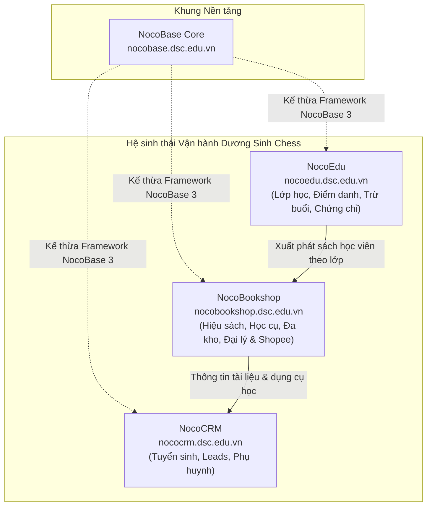

# Kế hoạch Triển khai NocoBookshop & Hệ sinh thái Dương Sinh Chess

Tài liệu này xác định kiến trúc, mô hình dữ liệu, lộ trình phát triển và kế hoạch đóng gói triển khai cho **NocoBookshop** (`nocobookshop.dsc.edu.vn`) — phân hệ Hiệu sách, Dụng cụ thi đấu, Quản lý kho đa cơ sở và Kênh phân phối đại lý của Công ty CP Cờ vua Dương Sinh.

## 1. Vị trí NocoBookshop trong Hệ sinh thái Dương Sinh Chess

NocoCRM chuyên trách Tuyển sinh, Phụ huynh và Doanh số khóa học. NocoEdu chuyên trách Giảng dạy, Điểm danh 1 chạm, Trừ số buổi và Chứng chỉ tốt nghiệp. NocoBookshop độc lập chuyên trách Bán sách và Học cụ qua 4 kênh (Web, Fanpage, Shopee, Nhà sách đối tác), Quản trị kho đa cơ sở, Ký gửi đại lý và Thanh toán VietQR SePay tự động.

## 2. Kế thừa từ `duongsinh-app` & Kế hoạch 4.2

Dựa trên kết quả rà soát từ `covuaduongsinh/duongsinh-app` và tài liệu kế hoạch mở rộng giai đoạn 4.2 (`docs/plans/2026-11-02-giai-doan-4-2-hieu-sach-phan-phoi.md`):

1. **Danh mục 37 đầu sách cờ vua**: Kế thừa danh mục chuẩn các bộ sách chuyên khảo, sách bài tập cờ vua do Dương Sinh xuất bản và phát hành, kèm các sản phẩm bộ cờ vua tiêu chuẩn thi đấu quốc tế, đồng hồ thi đấu DGT và Leap.
2. **Cơ cấu đa kho vật lý & kho ký gửi**: Kho trung tâm tại Trụ sở và Hiệu sách Tôn Đức Thắng; Kho cơ sở đào tạo tại CLB Kim Liên và CLB Vĩnh Phúc; Kho ký gửi đối tác tại từng nhà sách (Fahasa, Phương Nam, Tiền Phong...) có một kho ký gửi riêng biệt để quản lý công nợ và đối soát.
3. **Quản lý đơn hàng 4 kênh**: Kênh Web đặt hàng trực tuyến công khai tại `nocobookshop.dsc.edu.vn/shop`; Kênh Fanpage có Form "Đơn nhanh" cho nhân viên trực fanpage nhập đơn khi phụ huynh nhắn tin; Kênh Shopee nhập file xuất đơn hàng (CSV/XLSX) từ Shopee Seller Center, tự động khớp SKU, trừ kho và đối soát doanh thu thực nhận; Kênh Nhà sách và B2B quản lý xuất bán sỉ hoặc ký gửi, tính chiết khấu theo hợp đồng đối tác.
4. **Tích hợp Thanh toán VietQR & SePay**: Mã chuyển khoản chuẩn `DSC DH#####`, tự động khớp thanh toán khi tiền vào tài khoản ngân hàng.

## 3. Kiến trúc Mô hình Dữ liệu (Database Schema)

NocoBookshop sử dụng chuẩn NocoBase 3 với Kysely QueryAdapter trên SQLite (`bookshop.sqlite`):

| Tên Collection            | Tên hiển thị       | Vai trò nghiệp vụ                           | Các trường dữ liệu chính                                                                                                                                                                                       |
| :------------------------ | :----------------- | :------------------------------------------ | :------------------------------------------------------------------------------------------------------------------------------------------------------------------------------------------------------------- |
| `bookshopProducts`        | Sản phẩm & Sách    | 37 đầu sách cờ vua, bàn cờ, đồng hồ, học cụ | `id`, `sku`, `name`, `type` (`sach`/`hoc_cu`/`khac`), `coverPrice`, `retailPrice`, `isbn`, `author`, `publisher`, `isDsPublished`, `stockMin`, `totalStock`, `active`                                          |
| `bookshopWarehouses`      | Kho hàng           | Quản lý kho chính, kho CLB, kho ký gửi      | `id`, `code`, `name`, `type` (`main`/`club`/`consignment`), `address`, `manager`, `active`                                                                                                                     |
| `bookshopInventory`       | Tồn kho            | Tồn kho theo từng kho và sản phẩm           | `id`, `warehouseId`, `productId`, `quantity`, `updatedAt`                                                                                                                                                      |
| `bookshopStockNotes`      | Phiếu kho          | Nhập in, xuất bán, chuyển kho, kiểm kê      | `id`, `code` (`PK#####`), `type` (`in_print`/`in_purchase`/`out_sale`/`out_student`/`transfer`/`audit`), `sourceWarehouseId`, `destWarehouseId`, `status`, `notes`                                             |
| `bookshopStockLines`      | Chi tiết phiếu kho | Dòng sản phẩm trong phiếu kho               | `id`, `stockNoteId`, `productId`, `quantity`, `unitPrice`                                                                                                                                                      |
| `bookshopCustomers`       | Khách hàng         | Khách mua sách lẻ, phụ huynh                | `id`, `fullName`, `phone`, `address`, `email`, `notes`                                                                                                                                                         |
| `bookshopOrders`          | Đơn hàng           | Đơn hàng 4 kênh bán lẻ và sỉ                | `id`, `code` (`DH#####`), `channel` (`web`/`fanpage`/`shopee`/`partner`/`pos`), `externalCode`, `warehouseId`, `customerId`, `status`, `paymentMethod`, `shippingFee`, `discount`, `totalAmount`, `paidAmount` |
| `bookshopOrderLines`      | Chi tiết đơn hàng  | Danh sách sách & dụng cụ của đơn            | `id`, `orderId`, `productId`, `quantity`, `unitPrice`, `discountPercent`, `totalAmount`                                                                                                                        |
| `bookshopPartners`        | Nhà sách đối tác   | Đại lý, nhà sách lớn (Fahasa...)            | `id`, `code`, `name`, `taxCode`, `address`, `contactName`, `phone`, `discountPercent`, `model` (`wholesale`/`consignment`), `debtLimit`, `currentDebt`                                                         |
| `bookshopReconciliations` | Đối soát ký gửi    | Đối soát định kỳ sách ký gửi đã bán         | `id`, `code` (`DS#####`), `partnerId`, `warehouseId`, `periodFrom`, `periodTo`, `totalAmount`, `status`                                                                                                        |

## 4. Thanh điều hướng Client UI (Sidebar)

1. 📊 **Tổng quan Hiệu sách** (`/`): Thống kê doanh thu theo ngày/tháng và theo 4 kênh (Web, Fanpage, Shopee, Nhà sách); Danh sách đơn hàng mới cần đóng gói giao đi; Cảnh báo đầu sách sắp hết hàng (tồn kho < định mức tối thiểu).
2. 📖 **Danh mục Sách & Học cụ** (`/products`): Bảng quản lý 37 đầu sách cờ vua & dụng cụ với bộ lọc phân loại, ảnh bìa, giá bìa, tồn kho; Dialog thêm/sửa thông tin sách, ISBN, nhà xuất bản, lần in.
3. 🛒 **Đơn hàng & Bán hàng** (`/orders`): Bộ lọc đơn hàng theo kênh, trạng thái thanh toán, trạng thái giao vận; Form "Tạo đơn nhanh" cho bán hàng tại quầy và fanpage; Nút in Phiếu giao hàng và Hóa đơn bán lẻ.
4. 🏬 **Quản lý Kho & Tồn kho** (`/inventory`): Bảng tồn kho thời gian thực theo từng kho (Tôn Đức Thắng, Kim Liên, Vĩnh Phúc, Ký gửi); Lập phiếu Nhập in xuất bản / Điều chuyển giữa các kho / Kiểm kê kho định kỳ.
5. 🤝 **Đại lý & Ký gửi** (`/partners`): Quản lý danh sách đối tác nhà sách, hợp đồng chiết khấu, hạn mức công nợ; Lập kỳ đối soát hàng ký gửi và ghi nhận thanh toán công nợ.
6. 📥 **Đối soát Shopee** (`/shopee`): Khu vực kéo thả file Excel/CSV từ Shopee Seller Center; Tự động map mã đơn, đối soát phí sàn và tiền thực nhận.
7. 📈 **Báo cáo & Tài chính** (`/reports`): Báo cáo đầu sách bán chạy nhất, doanh thu theo tác giả, tỷ suất lợi nhuận.

## 5. Lộ trình Triển khai Chi tiết

### Giai đoạn 1: Khởi tạo Kho mã nguồn & Thư mục Dự án

- [ ] **Bước 1.1**: Tạo GitHub repository công khai: `https://github.com/covuaduongsinh/nocobookshop`.
- [ ] **Bước 1.2**: Khởi tạo thư mục cục bộ `D:\code\nocobookshop` trên máy trạm theo cấu trúc NocoBase 3 app độc lập, liên kết Git remote tới `covuaduongsinh/nocobookshop`.
- [ ] **Bước 1.3**: Thiết lập cấu hình chuẩn `package.json`, `tsconfig.json`, `config.yml`, Tailwind CSS, ESLint, Prettier kế thừa từ `@nocobase/dev-config`.

### Giai đoạn 2: Thiết kế Schema Database & Bộ máy Nghiệp vụ Kho - Đơn hàng

- [ ] **Bước 2.1**: Viết migration định nghĩa toàn bộ 10 collection: `bookshopProducts`, `bookshopWarehouses`, `bookshopInventory`, `bookshopStockNotes`, `bookshopStockLines`, `bookshopCustomers`, `bookshopOrders`, `bookshopOrderLines`, `bookshopPartners`, `bookshopReconciliations`.
- [ ] **Bước 2.2**: Cài đặt seed dữ liệu mẫu ban đầu: 37 đầu sách cờ vua của Dương Sinh Chess, danh mục 3 kho nội bộ + 2 kho ký gửi (Fahasa, Phương Nam), bảng giá bìa và chiết khấu.
- [ ] **Bước 2.3**: Xây dựng `InventoryEngine` (tính tồn kho, chống xuất âm, tự sinh phiếu nhập xuất) và `OrderEngine` (tính tiền đơn hàng, mã VietQR SePay).
- [ ] **Bước 2.4**: Xây dựng service nhập và đối soát đơn hàng Shopee từ file CSV/XLSX.

### Giai đoạn 3: Xây dựng Giao diện Web Client NocoBookshop

- [ ] **Bước 3.1**: Xây dựng thương hiệu NocoBookshop: Logo biểu tượng Cuốn sách & Quân Cờ Vua Vàng Cam (Amber/Indigo), tiêu đề `NocoBookshop - Hiệu Sách Cờ Vua Dương Sinh`.
- [ ] **Bước 3.2**: Xây dựng thanh điều hướng Sidebar và các trang giao diện chuyên biệt: `bookshop-dashboard.tsx`, `bookshop-products.tsx`, `bookshop-orders.tsx`, `bookshop-inventory.tsx`, `bookshop-partners.tsx`, `bookshop-shopee.tsx`, `bookshop-reports.tsx`.

### Giai đoạn 4: Đóng gói Docker & Triển khai Production `nocobookshop.dsc.edu.vn`

- [ ] **Bước 4.1**: Viết `docker-compose.yml` cho container `nocobookshop-dsc-app` chạy trên port `13100` (hoặc cổng được phân bổ).
- [ ] **Bước 4.2**: Cấu hình Traefik trên VPS `217.15.160.118` nhận diện domain `nocobookshop.dsc.edu.vn` với chứng chỉ SSL Let's Encrypt tự động và HTTP/2.
- [ ] **Bước 4.3**: Thiết lập backup tự động dữ liệu `bookshop.sqlite`.

## 6. Tiêu chí Nghiệm thu (Acceptance Criteria)

1. Truy cập trực tiếp `https://nocobookshop.dsc.edu.vn/main` với SSL HTTPS xanh, hiển thị thương hiệu "NocoBookshop - Hiệu Sách Cờ Vua Dương Sinh".
2. Danh mục hiển thị đầy đủ các đầu sách cờ vua của Dương Sinh với giá bìa, giá bán lẻ và tồn kho theo từng kho.
3. Nhân viên có thể tạo đơn hàng nhanh, hệ thống tự động sinh mã đơn `DH#####`, trừ kho theo đúng kho xuất và sinh mã VietQR thanh toán.
4. Hỗ trợ nhập file Shopee xuất từ sàn để tự động khớp đơn hàng và tính doanh thu thực nhận.
5. Kho mã nguồn `nocobookshop` được lưu trữ đầy đủ tại `https://github.com/covuaduongsinh/nocobookshop`.
