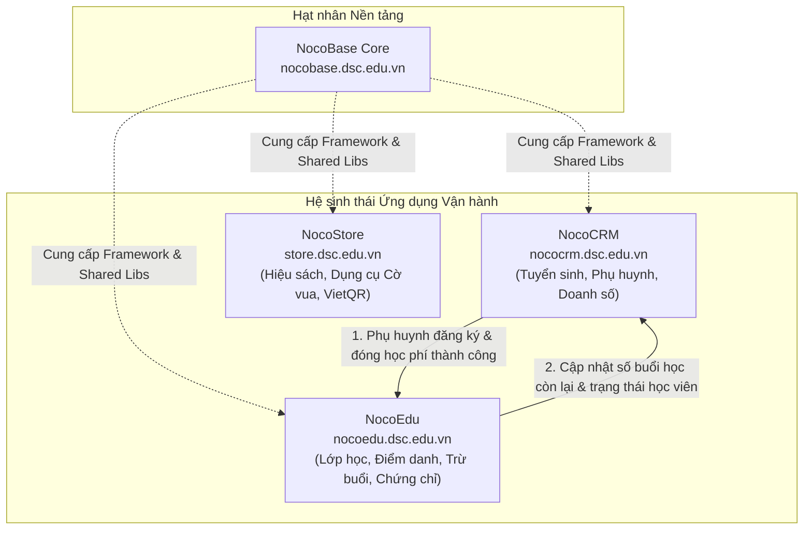

# Kế hoạch chi tiết triển khai NocoEdu & Rà soát bóc tách NocoCRM cho Hệ sinh thái Cờ Vua Dương Sinh

Tài liệu này xác định kiến trúc, lộ trình triển khai chi tiết cho phần mềm đào tạo **NocoEdu** (`nocoedu.dsc.edu.vn`) và phương án rà soát, tinh gọn **NocoCRM** (`nococrm.dsc.edu.vn`) nhằm xây dựng hệ sinh thái số chuyên nghiệp cho Công ty CP Cờ vua Dương Sinh.

## 1. Bối cảnh & Tầm nhìn Hệ sinh thái Dương Sinh Chess (DSC)

Hệ sinh thái số của Công ty Cổ phần Cờ vua Dương Sinh được quy hoạch rõ ràng thành các phân hệ độc lập, chuyên biệt nhưng gắn kết chặt chẽ theo chuẩn công nghệ **NocoBase 3 (Code-first, Modular, Full TypeScript, Node.js 24)**:

1. **NocoBase Core (`nocobase.dsc.edu.vn`)**: Khung nền tảng hạt nhân (Engine Core), đóng vai trò quản trị tập trung, tài khoản hệ thống, phân quyền đa ứng dụng, thư viện dùng chung (`@nocobase/db`, `@nocobase/app-server`, `@nocobase/app-client`) và studio cấu hình dữ liệu cấp cao.
2. **NocoCRM (`nococrm.dsc.edu.vn`)**: Ứng dụng Quản trị Tuyển sinh & Quan hệ Phụ huynh (B2C & B2B). Tập trung tối đa vào Sales Pipeline, Tiếp nhận Lead từ các kênh, Chăm sóc Phụ huynh, Quản lý giao dịch học phí, Lịch hẹn tư vấn, Kênh giao tiếp tự động (Zalo ZNS / WhatsApp / Email).
3. **NocoEdu (`nocoedu.dsc.edu.vn`)**: Ứng dụng Quản lý Giảng dạy & Đào tạo Học viện Cờ vua. Chịu trách nhiệm toàn diện về: Danh mục Khóa học, Quản lý Lớp học & Cơ sở, Lịch học từng buổi, Điểm danh 1 chạm (Attendance), Bộ máy tự động tính trừ số buổi học còn lại (quy tắc F0–F7), Đánh giá kỳ thi lên cấp và Xuất in chứng chỉ A4 hoàn thành khóa học chuẩn Typst/PDF.
4. **NocoStore (`store.dsc.edu.vn`)** _(Giai đoạn tiếp theo)_: Cửa hàng Sách cờ vua, Bàn cờ, Đồng hồ thi đấu & Thiết bị chuyên nghiệp, tích hợp thanh toán VietQR tự động qua SePay.

---

## 2. Kết quả Rà soát & Phương án Bóc tách NocoCRM

### 2.1. Đánh giá hiện trạng NocoCRM

- **Những phần giữ lại trong NocoCRM (Đúng nghiệp vụ Tuyển sinh & Bán hàng):**
  - `crmLeads`: Tiếp nhận thông tin học viên tiềm năng từ chiến dịch tuyển sinh, quảng cáo, giới thiệu.
  - `crmContacts`: Hồ sơ Phụ huynh / Người giám hộ / Người mua hàng (Đầu mối giao tiếp chính).
  - `crmCompanies`: Trường tiểu học, trường mầm non liên kết, câu lạc bộ trường đối tác (B2B).
  - `crmOpportunities`: Cơ hội bán hàng, đơn đăng ký khóa học, theo dõi tiến độ thu học phí.
  - `crmTasks` & `crmApprovals`: Lịch gọi điện tư vấn, lịch hẹn học thử, quy trình duyệt giảm giá/học bổng.
  - Kênh tương tác: Zalo ZNS / WhatsApp / Mail Timeline.

- **Những phần cần bóc tách / không triển khai trong NocoCRM:**
  - Mục **Học viên (`crmStudents`)** trên giao diện NocoCRM trước đây: Điều chỉnh lại vai trò. Trong NocoCRM, nhân viên Sales chỉ cần biết thông tin cơ bản của Bé gắn liền với Phụ huynh (`crmContacts`) để tư vấn chốt đơn (Tên bé, Năm sinh, Cấp độ cờ hiện tại). NocoCRM **không** chứa nghiệp vụ xếp lớp, phân công giáo viên, ghi nhận điểm danh từng buổi, hoặc in ấn chứng chỉ tốt nghiệp.
  - Toàn bộ nghiệp vụ Vận hành Lớp học, Điểm danh và Trừ buổi học sẽ được chuyển giao hoàn toàn sang **NocoEdu**.

---

## 3. Kiến trúc Chi tiết Phân hệ NocoEdu (`nocoedu.dsc.edu.vn`)

### 3.1. Cấu trúc Mô hình Dữ liệu (Schema) của NocoEdu

NocoEdu sẽ quản lý các collection chuyên biệt với chuẩn `@nocobase/db`:

| Mã Collection     | Tên hiển thị       | Vai trò nghiệp vụ                       | Các trường dữ liệu chính                                                                                                                                                                                                                               |
| :---------------- | :----------------- | :-------------------------------------- | :----------------------------------------------------------------------------------------------------------------------------------------------------------------------------------------------------------------------------------------------------- |
| `eduCourses`      | Khóa học           | Danh mục chương trình đào tạo cờ vua    | `id`, `name` (Nhập môn, Phong trào, Nâng cao...), `code`, `level` (L0 đến L5), `totalLessons` (12, 24 buổi), `tuitionFee`, `description`, `active`                                                                                                     |
| `eduClasses`      | Lớp học            | Lớp học theo cơ sở hoặc học online      | `id`, `name` (VD: T7-Chieu-CoSon1), `courseId`, `branch` (Cơ sở 1, Cơ sở 2, Online), `teacherId` (Giáo viên phụ trách), `scheduleDay`, `scheduleTime`, `maxCapacity`, `room`, `status` (`active`, `completed`, `suspended`)                            |
| `eduStudents`     | Hồ sơ Học viên     | Dữ liệu định danh học viên cờ vua       | `id`, `name`, `gender`, `birthDate`, `parentName`, `parentPhone`, `parentEmail`, `school`, `grade`, `chessLevel`, `ratingElo`, `status` (`studying`, `paused`, `graduated`)                                                                            |
| `eduEnrollments`  | Ghi danh Lớp       | Liên kết Học viên với Lớp học & Số buổi | `id`, `studentId`, `classId`, `registeredSessions` (Tổng buổi mua, VD: 24), `attendedSessions` (Đã học), `excusedAbsences` (Nghỉ có phép), `unexcusedAbsences` (Nghỉ không phép), `remainingSessions` (Buổi còn lại), `startDate`, `endDate`, `status` |
| `eduSessions`     | Buổi học chi tiết  | Lịch từng buổi học cụ thể của lớp       | `id`, `classId`, `sessionIndex` (Buổi 1, 2...), `date`, `startTime`, `endTime`, `teacherId`, `topic` (Bài giảng), `status` (`scheduled`, `in_progress`, `completed`, `cancelled`)                                                                      |
| `eduAttendance`   | Điểm danh 1 chạm   | Nhật ký chuyên cần từng buổi            | `id`, `sessionId`, `studentId`, `status` (`present`, `excused`, `unexcused`, `late`), `notes` (Nhận xét của thầy/cô), `homeworkSubmitted`, `deducted` (Đã trừ buổi: true/false)                                                                        |
| `eduCertificates` | Chứng chỉ Khóa học | Cấp chứng nhận tốt nghiệp khóa cờ vua   | `id`, `certificateNo` (Mã chứng chỉ duy nhất, VD: DSC-2026-001), `studentId`, `courseId`, `gradeRank` (Xuất sắc, Giỏi, Khá), `issueDate`, `signatoryName`, `pdfUrl`, `typstData`                                                                       |

### 3.2. Bộ máy tính toán tự động Điểm danh & Trừ số buổi học (F0–F7)

- **F0 (Trừ buổi chuẩn)**: Khi học viên có mặt (`present`) trong buổi học đã hoàn thành -> Tự động `attendedSessions += 1` và `remainingSessions -= 1`.
- **F1 (Nghỉ có phép)**: Học viên vắng có phép (`excused` báo trước >= 2 tiếng) -> `excusedAbsences += 1`, **không** trừ số buổi học còn lại (`remainingSessions` giữ nguyên), cấp lịch học bù nếu có lớp tương đương.
- **F2 (Nghỉ không phép)**: Học viên vắng không phép (`unexcused`) -> `unexcusedAbsences += 1` và tự động `remainingSessions -= 1` (theo quy chế học vụ câu lạc bộ).
- **F3 (Cảnh báo sắp hết học phí)**: Khi `remainingSessions <= 3` -> Tự động kích hoạt thông báo nhắc phụ huynh gia hạn khóa học (gửi sang NocoCRM hoặc bắn thông báo phụ huynh).
- **F4 (Cấp chứng chỉ tốt nghiệp)**: Khi học viên hoàn thành >= 80% số buổi của khóa và vượt qua bài thi đánh giá cấp độ -> Kích hoạt sinh chứng chỉ tốt nghiệp định dạng PDF A4 chuẩn Typst.

---

## 4. Lộ trình Triển khai Chi tiết từng Bước (Actionable Roadmap)

### Giai đoạn 1: Khởi tạo Repository & Khung Dự án NocoEdu (Thực hiện ngay)

- [x] **Bước 1.1**: Tạo GitHub repository công khai: `https://github.com/covuaduongsinh/nocoedu`.
- [x] **Bước 1.2**: Khởi tạo thư mục cục bộ `D:\code\nocoedu` trên máy trạm theo cấu trúc NocoBase 3 app độc lập, liên kết Git remote tới `covuaduongsinh/nocoedu`.
- [x] **Bước 1.3**: Thiết lập cấu hình chuẩn `package.json`, `tsconfig.json`, `config.yml`, Tailwind CSS, ESLint, Prettier kế thừa từ `@nocobase/dev-config`.

### Giai đoạn 2: Thiết kế Schema Database & Bộ máy Nghiệp vụ NocoEdu

- [x] **Bước 2.1**: Viết migration định nghĩa toàn bộ 7 collection: `eduCourses`, `eduClasses`, `eduStudents`, `eduEnrollments`, `eduSessions`, `eduAttendance`, `eduCertificates`.
- [x] **Bước 2.2**: Cài đặt seed dữ liệu mẫu ban đầu: Danh mục 5 khóa học chuẩn của Dương Sinh Chess, 2 cơ sở đào tạo, danh sách giáo viên, lớp học mẫu.
- [x] **Bước 2.3**: Xây dựng service nghiệp vụ điểm danh 1 chạm và bộ máy tự động tính toán trừ số buổi học còn lại.
- [x] **Bước 2.4**: Tích hợp template in chứng chỉ A4 hoàn thành khóa học (kết nối service Typstify đang chạy trên VPS `http://217.15.160.118:8080`).

### Giai đoạn 3: Tinh chỉnh Giao diện Web Client NocoEdu

- [x] **Bước 3.1**: Xây dựng thanh điều hướng Sidebar chuyên nghiệp cho NocoEdu:
  - 🏫 **Lớp học & Lịch giảng dạy**: Xem theo Tuần / Theo Cơ sở / Theo Giáo viên.
  - ✅ **Điểm danh 1 chạm**: Màn hình dành cho Giáo viên / Điểm danh nhanh trên máy tính bảng hoặc điện thoại.
  - 🎓 **Hồ sơ Học viên & Số buổi**: Tra cứu nhanh tiến độ học, số buổi còn lại, cảnh báo hết hạn.
  - 📜 **Chứng chỉ & Tốt nghiệp**: Danh sách chứng chỉ đã cấp, xem trước và in chứng chỉ A4 1 click.
  - ⚙️ **Cài đặt Học viện**: Danh mục Khóa học, Cơ sở vật chất, Bảng học phí.
- [x] **Bước 3.2**: Rà soát làm sạch NocoCRM: bóc tách mục "Học viên" ở NocoCRM chuyển hẳn sang NocoEdu, giữ NocoCRM tập trung vào Tuyển sinh, Leads, Phụ huynh và Báo cáo doanh số.

### Giai đoạn 4: Đóng gói Docker & Triển khai lên VPS `nocoedu.dsc.edu.vn`

- [x] **Bước 4.1**: Viết `docker-compose.yml` cho NocoEdu container `nocoedu-dsc-app`.
- [x] **Bước 4.2**: Cấu hình Traefik trên VPS `217.15.160.118` nhận diện domain `nocoedu.dsc.edu.vn` với HTTPS tự động (Let's Encrypt SSL) và HTTP/2.
- [x] **Bước 4.3**: Triển khai Release v3 với bộ nhận diện mới (Logo Quân Hậu Đỏ ♟ NocoEdu Chess), Vite production build, khởi chạy thành công.

---

## 5. Tiêu chuẩn Đánh giá Hoàn thành (Acceptance Criteria)

1. Truy cập trực tiếp `https://nocoedu.dsc.edu.vn` với chứng chỉ SSL hợp lệ, giao diện hiển thị thương hiệu "Dương Sinh Chess - NocoEdu".
2. Giáo viên có thể truy cập vào một buổi học cụ thể và bấm điểm danh 1 chạm cho học viên; hệ thống tự động trừ đúng số buổi học theo logic F0–F2.
3. Học sinh hoàn thành khóa học có thể được xuất chứng chỉ A4 đẹp mắt dạng PDF qua Typst chỉ bằng một cú nhấp chuột.
4. NocoCRM (`https://nococrm.dsc.edu.vn`) chạy ổn định, tinh gọn, tập trung hoàn toàn vào tuyển sinh, bán hàng và phụ huynh.
5. Mã nguồn `nocoedu` được kiểm soát phiên bản đầy đủ tại `https://github.com/covuaduongsinh/nocoedu`.
